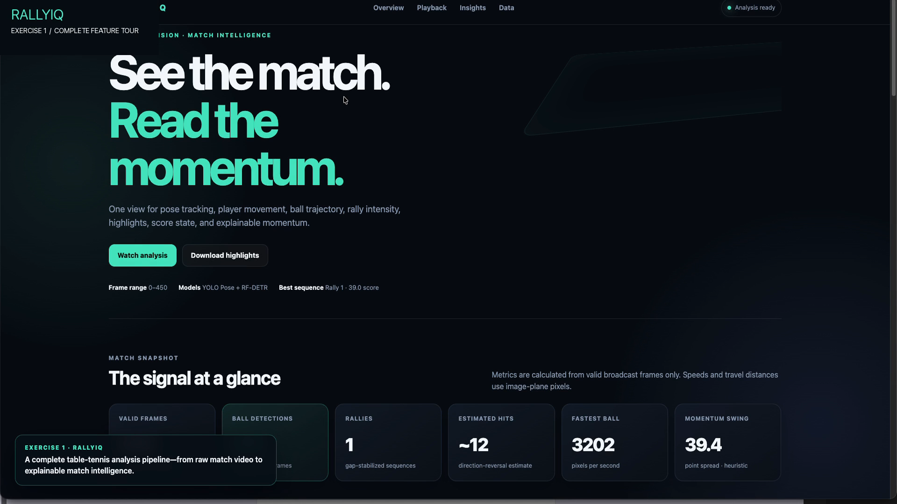

# RallyIQ — Table Tennis Match Intelligence

RallyIQ is an end-to-end computer-vision pipeline that turns table-tennis match footage into an annotated video, structured datasets, analytical charts, automatic highlights, and a responsive dashboard synchronized to every processed frame.

[Live demo](https://rallyiq-table-tennis.shaharmaaravi2706.chatgpt.site) · [96-second showcase video](https://rallyiq-table-tennis.shaharmaaravi2706.chatgpt.site/assets/rallyiq-showcase.mp4)



## What it does

- Detects players, bounding boxes, and pose keypoints with YOLO Pose.
- Filters invalid broadcast cuts using player geometry and pose visibility.
- Tracks a custom-trained table-tennis-ball detector with motion and temporal-continuity checks.
- Reads the broadcast scoreboard with EasyOCR.
- Calculates player positions, image-plane ball speed, rally segments, estimated contacts, highlights, and an explainable momentum index.
- Exports annotated video, CSV datasets, heatmaps, charts, and an interactive HTML dashboard.
- Synchronizes video playback, a Canvas timeline, source-frame numbers, ball speed, momentum, score, and tracked positions.

## Technology

- Python 3
- OpenCV
- Ultralytics YOLO Pose
- Roboflow Inference / custom RF-DETR ball model
- EasyOCR
- NumPy
- Matplotlib
- HTML, CSS, and vanilla JavaScript
- Canvas 2D and `ResizeObserver`

## Processing pipeline

```text
input.mp4
  → OpenCV frame reader
  → YOLO pose detection
  → valid-frame filtering
  → Roboflow ball detection + temporal filtering
  → EasyOCR scoreboard sampling
  → rally, speed, movement and momentum analytics
  → video / CSV / PNG outputs
  → synchronized static dashboard
```

## Run locally

1. Create and activate a virtual environment:

   ```bash
   python3 -m venv .venv
   source .venv/bin/activate
   ```

2. Install dependencies:

   ```bash
   pip install -r requirements.txt
   ```

3. Copy `.env.example` to `.env`, then provide your own Roboflow credentials:

   ```bash
   cp .env.example .env
   ```

4. Add the source video as `input.mp4`.

5. Run the analyzer:

   ```bash
   python table_tennis_analyzer.py
   ```

6. Serve the generated dashboard over HTTP:

   ```bash
   python3 -m http.server 8000
   ```

   Then open `http://localhost:8000/dashboard.html`.

## Main outputs

- `output_with_detections.mp4`
- `match_highlights.mp4`
- `player_positions.csv`
- `ball_positions.csv`
- `rally_statistics.csv`
- `match_momentum.csv`
- `player_position_heatmap.png`
- `ball_speed_over_time.png`
- `score_over_time.png`
- `rally_analysis.png`
- `match_momentum.png`
- `dashboard.html`

Generated media, datasets, model weights, caches, the input video, the virtual environment, and `.env` are intentionally excluded from Git.

## Measurement notes

- Ball speed is reported in image-plane pixels per second, not physical km/h.
- Player 1 and Player 2 are assigned by left/right screen position for the fixed side-view camera.
- Rally contacts, excitement, and momentum are explainable heuristics rather than official match statistics.
- Dashboard-only speed smoothing improves presentation without modifying raw CSV values or downstream analytics.

## Portfolio links

- **Demo:** <https://rallyiq-table-tennis.shaharmaaravi2706.chatgpt.site>
- **Showcase:** <https://rallyiq-table-tennis.shaharmaaravi2706.chatgpt.site/assets/rallyiq-showcase.mp4>
- **Author:** Shahar Maaravi
